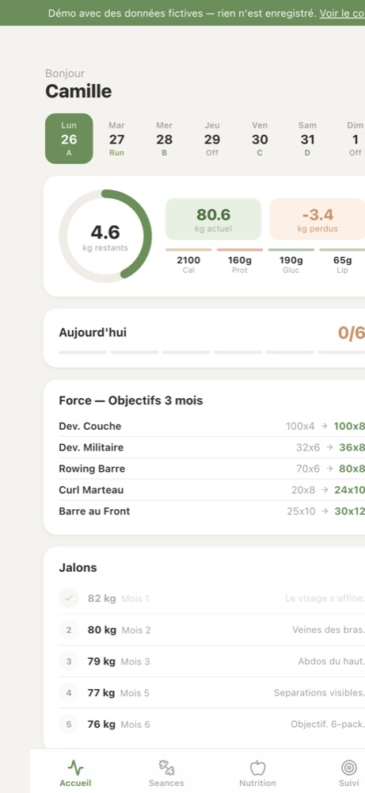

# Coach de Poche

Application de suivi d'entraînement et de nutrition, pensée pour le téléphone (ajout à l'écran d'accueil de l'iPhone).

**Démo** : https://coach-de-poche.vercel.app — profil et historique fictifs, rien n'est enregistré.



## Fonctionnalités

- **Séances** : programme sur quatre séances (push, pull, jambes, épaules-bras) avec séries, répétitions, charges cibles et temps de repos ; saisie des charges réalisées série par série
- **Nutrition** : check-list quotidienne (protéines, eau, sommeil, créatine…) et journal des repas, de l'énergie et du ressenti
- **Suivi** : courbe de poids et de masse grasse, historique des séances
- **Export CSV** de toutes les données, prêt à être analysé (par exemple par un LLM jouant le rôle de coach)

## Stack

React 18, Vite, Supabase (PostgreSQL), Lucide. Déployé sur Vercel.

## Deux modes

- **Démo** (`VITE_DEMO_MODE=true`) : `src/demoClient.js` remplace le client Supabase par une base en mémoire qui imite les mêmes requêtes, pré-remplie avec six semaines générées. Aucune donnée ne quitte le navigateur.
- **Usage réel** : les données sont lues et écrites dans un projet Supabase. Le profil (prénom, poids de départ, objectif) vient des variables d'environnement, pas du code.

## Organisation du code

| Fichier | Rôle |
|---|---|
| `src/data.js` | Programme d'entraînement (séances, exercices, consignes) |
| `src/hooks.js` | Hooks d'accès aux données Supabase et export CSV |
| `src/demoClient.js` | Client en mémoire du mode démo |
| `src/App.jsx` | Interface : onglets Accueil, Séances, Nutrition, Suivi |

## Lancer en local

```bash
npm install
npm run dev
```

Sans configuration, lancer `VITE_DEMO_MODE=true npm run dev`. Pour l'usage réel, copier `.env.example` en `.env.local` et renseigner le projet Supabase (tables `weight_log`, `daily_checks`, `daily_log`, `workout_log`).
